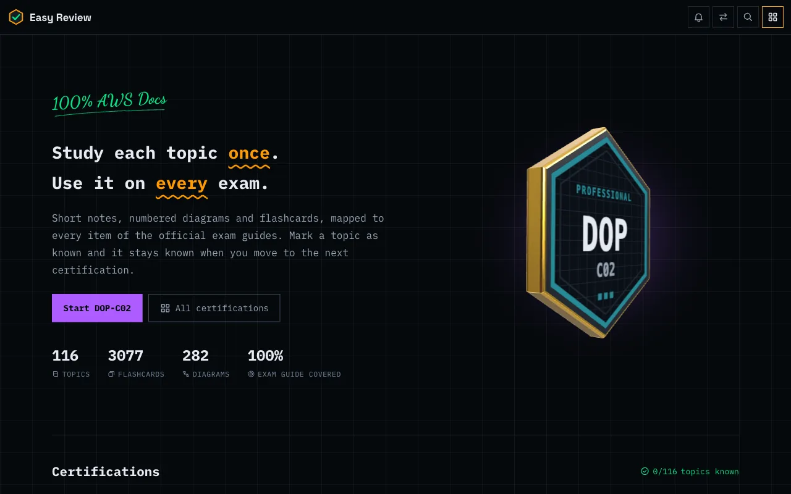
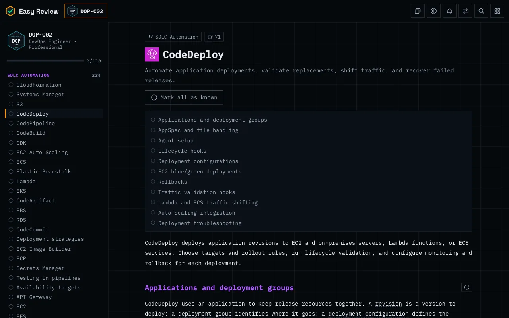
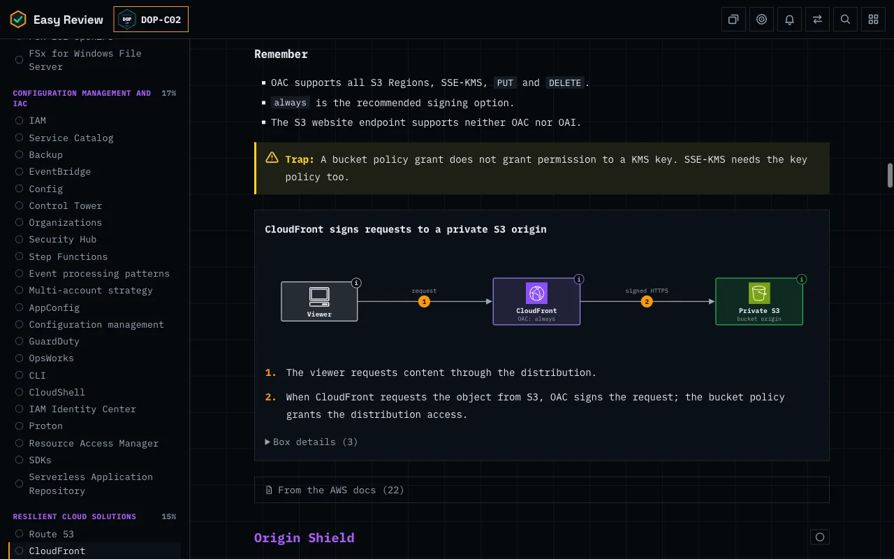
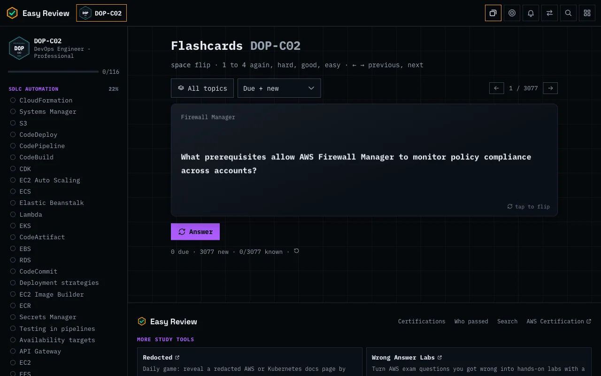
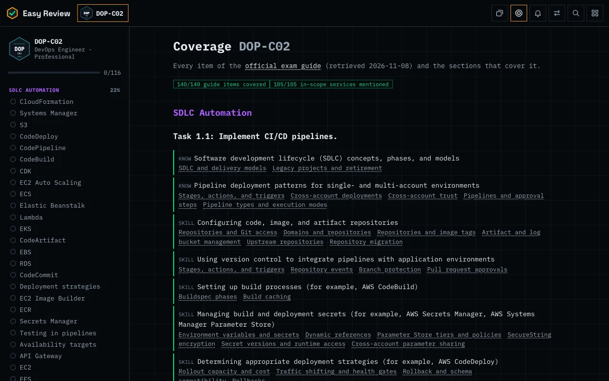
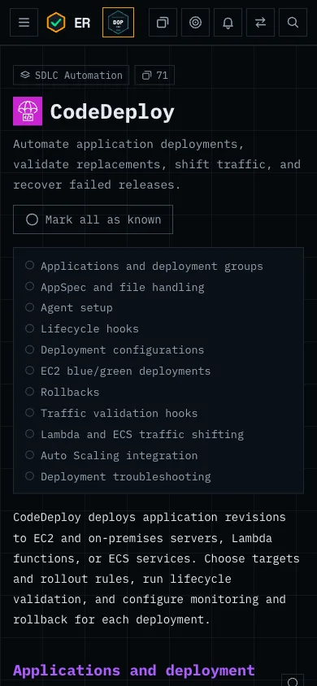

<div align="center">


# Easy Review

Free study notes for AWS Certification exams: short sections, step-by-step diagrams and spaced-repetition flashcards, all written from the AWS documentation.

**[jhermesn.dev/easyreview](https://jhermesn.dev/easyreview/)**

[](https://github.com/jhermesn/easyreview/actions/workflows/deploy.yml)
[](https://github.com/jhermesn/easyreview/actions/workflows/content-health.yml)
[](LICENSE)
[](LICENSE-CONTENT.md)



</div>

Two exams are covered in full: **AWS Certified Cloud Practitioner (CLF-C02)** and **AWS Certified DevOps Engineer - Professional (DOP-C02)**. Every item of their exam guides and every in-scope service is mapped to a unit. Units are shared, so a topic marked as known counts in every exam that uses it. The other AWS Certifications show as coming soon and reuse the same units as they are added.

## What's in it

| | |
|---|---|
|  | **Units and sections.** A unit is one AWS service or concept, split into sections of a few minutes' reading: what it is, how it works, exam cues, what to remember, traps. |
|  | **Facts with sources.** Numbers, limits, defaults and dates live in facts, and every fact links the exact AWS documentation page. A weekly job flags facts whose cited doc section changed. |
|  | **Diagrams** with official AWS Architecture Icons and numbered steps, for request flows, failover sequences and order of execution. |
|  | **Flashcards** with spaced repetition, a missed-only mode and a traps-only mode. |
|  | **Study once, use it everywhere.** A section you mark as known stays known in every exam that includes it. A cert's badge turns gold once you know every topic. |
|  | **Exam guide coverage** per cert: which guide items and in-scope services each section covers. |
|  | **Exam facts** (duration, format, cost, passing score), refreshed weekly from the AWS certification pages. |
|  | **Your progress, your browser.** No accounts and no trackers. Move progress to another device with a code. |
|  | **Who passed:** people who studied here add themselves by pull request, checked against their public Credly badges. |

## Screenshots

<table>
  <tr>
    <td width="50%"></td>
    <td width="50%"></td>
  </tr>
  <tr>
    <td>A unit and its sections</td>
    <td>Diagrams with numbered steps</td>
  </tr>
  <tr>
    <td></td>
    <td></td>
  </tr>
  <tr>
    <td>Spaced-repetition flashcards</td>
    <td>Exam guide coverage</td>
  </tr>
</table>

<p align="center"></p>

## Run it locally

```sh
npm install
npm run dev     # http://localhost:4321/easyreview/
npm run lint    # section and diagram checks
npm run build   # static site in dist/
```

Node 24 or later.

## Contributing

Fixes to facts, new sections for exams that are coming soon, and site improvements are all welcome. Start with [CONTRIBUTING.md](CONTRIBUTING.md). The rules, content model and formats are in [docs/](docs/), indexed by [AGENTS.md](AGENTS.md) for people and AI agents alike.

Found a wrong fact? [Open a content error issue](https://github.com/jhermesn/easyreview/issues/new?template=content-error.yml) with the AWS documentation link that shows the right answer.

## License

Code: [MIT](LICENSE). Study content: [CC BY 4.0](LICENSE-CONTENT.md). Third-party material, including the AWS Architecture Icons, is listed in [NOTICE.md](NOTICE.md).

Easy Review is independent and not affiliated with Amazon Web Services. When the notes and the official docs or exam guide disagree, the official sources win.
